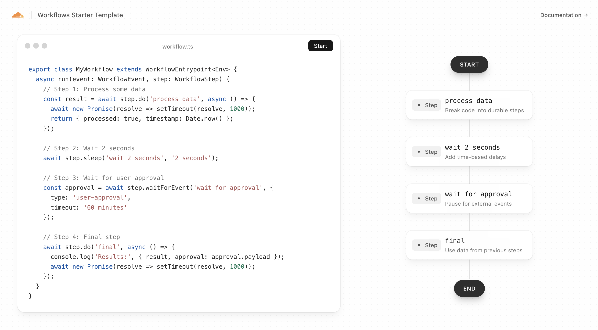

# Cloudflare Workflows Orchestration Lab

[](https://deploy.workers.cloudflare.com/?url=https://github.com/cloudflare/templates/tree/main/workflows-starter-template)

A real-time interactive demo for two advanced orchestration patterns built on [Cloudflare Workflows](https://developers.cloudflare.com/workflows):

- **AI agent with Human-in-the-Loop (HITL)** approval before irreversible actions.
- **Parallel multi-agent orchestration** with a parent workflow that fans out child workflows and aggregates results.

Live updates are streamed over WebSockets via Durable Objects.



## Getting Started

### Installation

```bash
npm install
```

### Development

```bash
npm run dev
```

Visit `http://localhost:5173` to run the orchestration lab.

### Deployment

```bash
npm run deploy
```

## Runtime bindings

This project uses:

- `AI` Workers AI binding (`wrangler.jsonc`)
- Workflow bindings:
  - `MY_WORKFLOW` (legacy starter workflow)
  - `AI_AGENT_WORKFLOW` (HITL agent)
  - `ORCHESTRATOR_WORKFLOW` (parent workflow)
  - `AGENT_WORKFLOW` (child workflow)
- Durable Objects:
  - `WORKFLOW_STATUS` (websocket state)
  - `AGGREGATOR_DO` (multi-agent aggregation)

## Learn More

- [Cloudflare Workflows Documentation](https://developers.cloudflare.com/workflows)
- [Durable Objects Documentation](https://developers.cloudflare.com/durable-objects)
- [Workers AI Documentation](https://developers.cloudflare.com/workers-ai/)
- [Workers Documentation](https://developers.cloudflare.com/workers)
